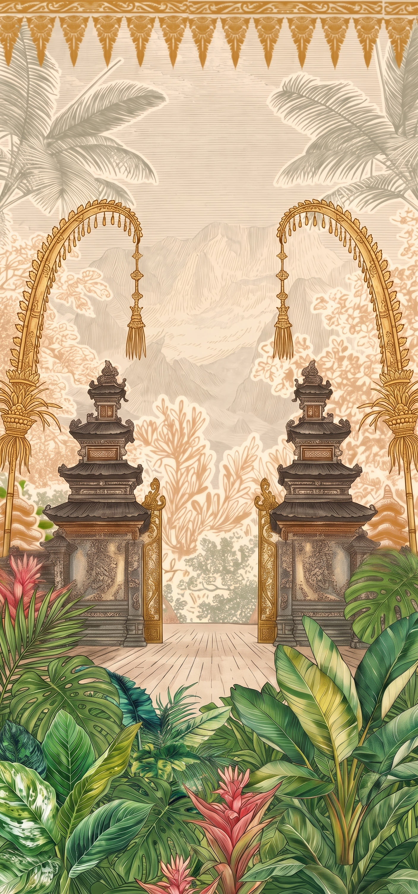
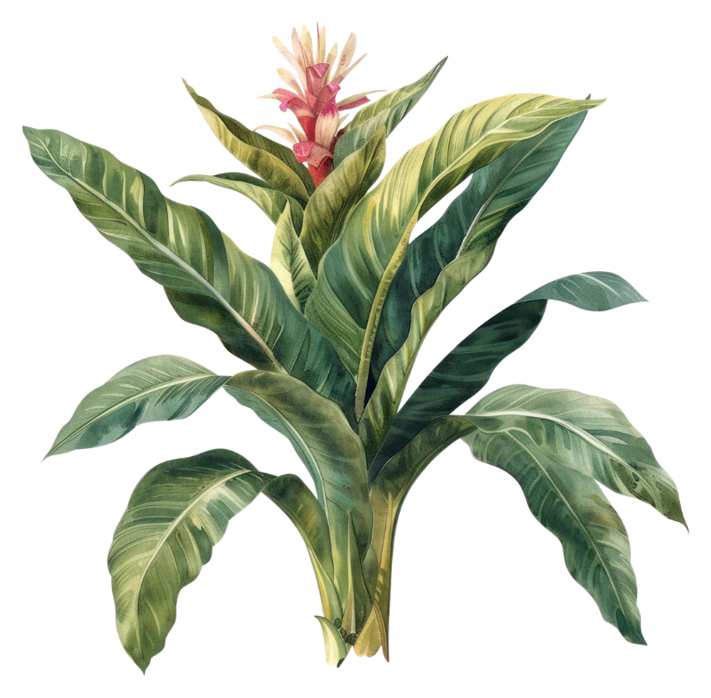

# animation.md — Undangan Pernikahan Guswik & Fitri

> Spesifikasi gerak untuk page awal dan transisi ke page berikutnya.
> Pasangan dokumen: [`design.md`](./design.md). ID elemen (`L0-bg`, `FG-BL`, dst.) dan token mengacu ke sana.
> Semua ID di dokumen ini (mis. `A-24`) bisa dicari dengan Ctrl+F.

## Daftar isi

| ID | Modul | Isi singkat |
|---|---|---|
| A-01 | Tanda gerak dari video | 6 ciri gerak yang dipertahankan + 3 tambahan |
| A-10 | Token gerak | Durasi, easing, jarak |
| A-20 | Timeline intro (master) | Tabel waktu semua elemen |
| A-21 | Wash-to-clear (background) | |
| A-22 | Dedaunan tumbuh | |
| A-23 | Kertas mendarat | |
| A-24 | Tulisan nama | Reveal ala ditulis tangan |
| A-25 | Pena & tinta | |
| A-26 | Tombol | |
| A-27 | Idle (hidup pelan) | Sway, daun melayang, napas kertas |
| A-30 | Transisi "Buka Gapura" | Cover → page 2 |
| A-35 | Reveal saat scroll (page 2) | Pola ringkas |
| A-40 | Implementasi | Struktur HTML, kerangka GSAP, alternatif CSS |
| A-50 | Reduced motion & performa | |
| A-60 | Checklist QA | |

---

## A-01 Tanda gerak dari video

Video referensi (16 detik, loop) memiliki urutan gerak berikut. Keenam ciri pertama dipertahankan; tampilan visualnya tidak ditiru.

| # | Ciri di video | Terjemahan di proyek ini | Modul |
|---|---|---|---|
| 1 | Latar muncul pucat dan kabur, lalu jernih | Background `wash → clear` | A-21 |
| 2 | Dedaunan dan bunga tumbuh dari tepi, berlapis | Rumpun PNG tumbuh dari sudut bawah, stagger | A-22 |
| 3 | Pita border turun dari atas | Background turun halus + kilau emas di pita atas | A-21 |
| 4 | Teks kecil muncul dengan jarak huruf melebar | Eyebrow tracking-in | A-24 |
| 5 | Nama tampil seperti ditulis tangan | Mask reveal kiri→kanan per kata | A-24 |
| 6 | Adegan ditahan, lalu bernapas pelan | Idle: sway, daun melayang | A-27 |

**Tambahan khas proyek ini**
- Kertas surat meluncur dan mendarat dengan sedikit rotasi (A-23).
- Pena + tinta ikut bergerak saat nama ditulis (A-25).
- Transisi "Buka Gapura": kamera maju melewati pintu gapura di ilustrasi (A-30).

---

## A-10 Token gerak

```css
:root {
  /* durasi */
  --d-xs: 240ms;  --d-sm: 450ms;  --d-md: 800ms;
  --d-lg: 1200ms; --d-xl: 2000ms;

  /* easing */
  --ease-out:     cubic-bezier(.22, 1, .36, 1);   /* tumbuh, mendarat */
  --ease-inout:   cubic-bezier(.65, 0, .35, 1);   /* transisi kamera */
  --ease-write:   cubic-bezier(.4, 0, .2, 1);     /* tulisan tangan */
  --ease-settle:  cubic-bezier(.34, 1.3, .64, 1); /* sedikit overshoot */

  /* jarak */
  --shift-sm: 12px;  --shift-md: 28px;  --shift-lg: 40vh;
}
```

Padanan GSAP: `--ease-out` ≈ `power3.out`, `--ease-inout` ≈ `power2.inOut`, `--ease-settle` ≈ `back.out(1.2)`, `--ease-write` ≈ `power1.inOut`.

Aturan umum: animasikan **hanya** `transform`, `opacity`, `filter` (dan `mask-position` untuk tulisan). Jangan menganimasikan `top/left/width/height`.

---

## A-20 Timeline intro (master)

Total ± **7,4 detik**. Waktu dalam detik dari awal.

| Mulai | Selesai | Elemen | Dari → ke | Easing | Modul |
|---|---|---|---|---|---|
| 0,0 | 1,2 | `L0-bg` opacity | 0 → 1 | linear | A-21 |
| 0,0 | 2,0 | `L0-bg` filter | `blur(8px) saturate(.35) brightness(1.12)` → `none` | `--ease-out` | A-21 |
| 0,0 | 2,2 | `L0-bg` transform | `translateY(-2.5%) scale(1.06)` → `none` | `--ease-out` | A-21 |
| 0,9 | 1,9 | `L1-shine` | geser kiri → kanan, opacity 0 → .8 → 0 | `--ease-inout` | A-21 |
| 0,8 | 2,2 | `FG-BL` | scale .55, rotate -8°, opacity 0 → 1, 0°, 1 | `--ease-out` | A-22 |
| 0,95 | 2,35 | `FG-BR` | scale .55, rotate 8°, opacity 0 → 1, 0°, 1 | `--ease-out` | A-22 |
| 1,1 | 2,5 | `FG-BC` | scale .6, y 8vw, opacity 0 → 1 | `--ease-out` | A-22 |
| 1,3 | 2,7 | `FG-TL`, `FG-TR` *(opsional)* | scale .6, opacity 0 → 1 | `--ease-out` | A-22 |
| 1,8 | 3,0 | `L4-paper` | `y +40vh, rotate 4°, opacity 0` → `y 0, rotate -1.2°, opacity 1` | `--ease-settle` | A-23 |
| 2,6 | 3,3 | `L5-paper-flowers` (×3) | scale .6, opacity 0 → 1 (stagger 0,12) | `--ease-out` | A-23 |
| 3,0 | 3,9 | Eyebrow | letter-spacing .6em → .3em, opacity 0 → 1 | `--ease-out` | A-24 |
| 3,4 | 4,0 | `L6-ink` | `x 20px, rotate 14°, opacity 0` → `x 0, rotate 8°, opacity 1` | `--ease-out` | A-25 |
| 3,6 | 4,7 | Nama "Guswik" | mask reveal | `--ease-write` | A-24 |
| 4,7 | 5,1 | "&" | mask reveal | `--ease-write` | A-24 |
| 5,1 | 6,2 | Nama "Fitri" | mask reveal | `--ease-write` | A-24 |
| 3,6 | 6,2 | Pena (wobble) | rotate ±3°, selama menulis | `sine.inOut` | A-25 |
| 6,2 | 7,0 | Tagline | opacity 0 → 1, y 6px → 0 | `--ease-out` | A-24 |
| 6,8 | 7,4 | Tombol | opacity 0 → 1, y 12px → 0 | `--ease-out` | A-26 |
| 7,4 | ∞ | Idle | lihat A-27 | | A-27 |

**Lewati intro:** satu ketukan di mana saja sebelum t = 7,4 → `timeline.progress(1)` (langsung ke keadaan akhir). Kunjungan berikutnya dalam sesi yang sama memutar versi cepat (`timeScale(2.2)`).

---

## A-21 Wash-to-clear (background)

Meniru adegan awal video: latar tampak pucat/berembun, lalu jernih.

```css
.bg {                       /* L0-bg */
  opacity: 0;
  filter: blur(8px) saturate(.35) brightness(1.12);
  transform: translateY(-2.5%) scale(1.06);
  transform-origin: 50% 40%;
}
.bg.is-in {
  opacity: 1; filter: none; transform: none;
  transition:
    opacity   1200ms linear,
    filter    2000ms var(--ease-out),
    transform 2200ms var(--ease-out);
}
```

**Kilau emas pita atas (`L1-shine`)** menggantikan gerak "border turun" dari video, sebab pita sudah menyatu di `Background.jpg`.

```css
.shine {
  position: absolute; inset: 0 0 auto 0; height: 17vw;   /* ≈ tinggi pita emas */
  background: linear-gradient(100deg, transparent 35%, var(--gold-300) 50%, transparent 65%);
  mix-blend-mode: overlay; opacity: 0;
  transform: translateX(-100%);
}
.shine.is-in { animation: shine 1000ms var(--ease-inout) 900ms 1 forwards; }
@keyframes shine {
  0%   { transform: translateX(-100%); opacity: 0; }
  40%  { opacity: .8; }
  100% { transform: translateX(100%);  opacity: 0; }
}
```

---

## A-22 Dedaunan tumbuh

Setiap rumpun tumbuh dari titik pangkalnya (lihat `transform-origin` di `design.md`, DS-42).

| ID | Dari | Ke | Delay | Durasi |
|---|---|---|---|---|
| `FG-BL` | `scale(.55) rotate(-8deg)`, opacity 0 | `none`, opacity 1 | 0,8 s | 1,4 s |
| `FG-BR` | `scale(.55) rotate(8deg)`, opacity 0 | `none`, opacity 1 | 0,95 s | 1,4 s |
| `FG-BC` | `scale(.6) translateY(8vw)`, opacity 0 | `none`, opacity 1 | 1,1 s | 1,4 s |
| `FG-TL/TR` | `scale(.6)`, opacity 0 | `none`, opacity 1 | 1,3 s | 1,4 s |

Easing: `--ease-out`. Opacity selesai di ±45 % durasi agar terasa tumbuh, bukan sekadar muncul.

---

## A-23 Kertas mendarat

1. Kertas masuk dari bawah layar: `translateY(40vh) rotate(4deg)`, opacity 0.
2. Mendarat di tengah dengan `--ease-settle` (overshoot kecil ±6 px), berhenti di `rotate(-1.2deg)`.
3. Bayangan ikut berubah: awal rapat-gelap (`0 4px 6px`), akhir lebar-lembut (nilai di `design.md`, DS-53). Animasikan lewat pseudo-element berisi bayangan dengan opacity, bukan `box-shadow` langsung.
4. Bunga sudut (`L5-paper-flowers`) menyusul dengan stagger 0,12 s, masing-masing `scale(.6) → 1` dari titik tempel di tepi kertas.

---

## A-24 Tulisan nama

### Eyebrow (tracking-in)

```css
.letter__eyebrow { opacity: 0; letter-spacing: .6em; }
.letter__eyebrow.is-in {
  opacity: 1; letter-spacing: .30em;
  transition: opacity 900ms var(--ease-out), letter-spacing 900ms var(--ease-out);
}
```

### Nama (reveal ala tulis tangan)

Mask gradasi digeser dari kanan ke kiri sehingga huruf muncul dari kiri ke kanan dengan tepi lembut.

```css
.letter__names .w {
  -webkit-mask-image: linear-gradient(90deg, #000 0%, #000 40%, transparent 60%, transparent 100%);
          mask-image: linear-gradient(90deg, #000 0%, #000 40%, transparent 60%, transparent 100%);
  -webkit-mask-size: 250% 100%;           mask-size: 250% 100%;
  -webkit-mask-position: 100% 0;          mask-position: 100% 0;
  -webkit-mask-repeat: no-repeat;         mask-repeat: no-repeat;
  transform: translateY(6px);
}
.letter__names .w.is-writing {
  animation: write var(--dur, 1100ms) var(--ease-write) var(--delay, 0ms) forwards;
}
@keyframes write {
  to { -webkit-mask-position: 0 0; mask-position: 0 0; transform: translateY(0); }
}
.w--1 { --dur: 1100ms; --delay: 0ms;    }  /* Guswik */
.w--amp { --dur: 400ms;  --delay: 1100ms; }  /* &      */
.w--2 { --dur: 1100ms; --delay: 1500ms; }  /* Fitri  */
```

**Opsi lanjutan (tulisan benar-benar tergambar):** ubah nama menjadi path SVG (outline font atau tracing), lalu gunakan `stroke-dasharray`/`stroke-dashoffset` bertahap, dengan fill terakota muncul setelah goresan selesai. Hanya dilakukan bila hasil mask kurang meyakinkan.

### Tagline
`opacity 0 → 1`, `translateY(6px → 0)`, 800 ms, `--ease-out`, mulai 6,2 s.

---

## A-25 Pena & tinta

- `L6-ink` masuk (A-20), lalu selama nama ditulis (3,6–6,2 s) bergoyang pelan: `rotate(8° ↔ 11°)` dan `translateY(0 ↔ -2px)`, periode 0,45 s, `sine.inOut`.
- Saat tulisan selesai, pena kembali ke `rotate(8deg)` dalam 400 ms dan berhenti bergerak (bergabung ke idle A-27 dengan amplitudo kecil).
- Opsional: titik tinta kecil (lingkaran terakota 3 px) muncul di awal tiap kata, `scale 0 → 1 → .8`, 200 ms.

---

## A-26 Tombol

Muncul pada 6,8 s: `opacity 0 → 1`, `translateY(12px → 0)`, 600 ms. Setelah tampil, denyut halus pada garis emas:

```css
.cta.is-ready { animation: pulse 2800ms ease-in-out infinite; }
@keyframes pulse {
  0%, 100% { box-shadow: 0 0 0 0 rgba(197,138,60,.0); }
  50%      { box-shadow: 0 0 0 8px rgba(197,138,60,.18); }
}
```

Hover/tekan: `scale(.97)`, 120 ms. Tombol tidak dapat diklik sebelum 7,0 s kecuali pengguna melewati intro.

---

## A-27 Idle (hidup pelan)

Idle dimulai per elemen begitu animasi masuknya selesai, dengan amplitudo naik bertahap selama 1 detik.

| Elemen | Gerak | Amplitudo | Periode | Catatan |
|---|---|---|---|---|
| `FG-BL`, `FG-BR`, `FG-BC` | Sway rotasi dari pangkal | ±1,2° | 5,5 / 7 / 6,2 s | Fase berbeda tiap rumpun |
| `FG-TL/TR` | Sway | ±1,8° | 6 s | |
| `L4-paper` | Mengambang | ±3 px (y), ±0,3° | 6 s | Bayangan menipis saat naik |
| `L6-ink` | Goyang kecil | ±1,5° | 5 s | |
| Daun melayang (`L3b-drift`) | Jatuh diagonal pelan, berputar | lihat bawah | 14–22 s | 3–5 elemen |
| `L1-shine` | Kilau ulang | — | tiap 12 s | Sekali sapuan |

**Daun melayang:** pilih acak dari `leave1–7.png`, lebar 6–10vw, mulai di luar atas layar pada x acak; jalur turun `translateY(-12vh → 112vh)`, geser x berbentuk sinus ±8vw, rotasi satu putaran penuh, opacity `0 → .9 → 0` (10 % / 80 % / 100 %). Hanya satu daun mulai tiap 3–5 detik.

```css
@keyframes sway {
  0%, 100% { transform: rotate(calc(var(--amp, 1.2deg) * -1)); }
  50%      { transform: rotate(var(--amp, 1.2deg)); }
}
.fg { animation: sway var(--period, 6s) ease-in-out infinite; transform-origin: var(--origin); }
```

---

## A-30 Transisi "Buka Gapura"

Pemicu: ketuk tombol "Buka Undangan" atau geser ke atas. Total ± **2,4 detik**. Latar mempertahankan gaya video (lapisan berpisah, bergerak berbeda arah) dan memakai pintu gapura pada `Background.jpg` sebagai titik tujuan.

| Mulai | Selesai | Elemen | Gerak | Easing |
|---|---|---|---|---|
| 0,0 | 0,4 | Tombol | opacity → 0, y +8px | `--ease-out` |
| 0,0 | 0,4 | Idle | semua idle dihentikan (`pause`) | — |
| 0,1 | 1,0 | `L4-paper` + bunga + `L6-ink` | `y -30vh`, `rotate -4°`, opacity → 0 (surat diangkat dari pandangan) | `--ease-inout` |
| 0,3 | 1,8 | `FG-BL` | `x -35vw`, `scale 1.25`, opacity → 0 | `--ease-inout` |
| 0,3 | 1,8 | `FG-BR` | `x +35vw`, `scale 1.25`, opacity → 0 | `--ease-inout` |
| 0,4 | 1,8 | `FG-BC`, `FG-TL/TR` | `y +20vw`, opacity → 0 | `--ease-inout` |
| 0,3 | 2,2 | `L0-bg` | `scale 1 → 1.55`, `transform-origin: 50% 66%` (celah pintu gapura) | `--ease-inout` |
| 1,5 | 2,3 | Veil `--cocoa-800` | opacity 0 → 1 menutup layar | `--ease-inout` |
| 2,0 | 2,4 | Page 2 hero | opacity 0 → 1, `y 24px → 0` | `--ease-out` |

Setelah selesai:
1. Hapus elemen cover dari DOM (atau `display:none`).
2. Buka kunci scroll (`body { overflow: auto }`) dan `window.scrollTo(0, 0)`.
3. Pindahkan fokus ke judul page 2 (`tabindex="-1"` lalu `focus()`).

Selama intro dan transisi, `body` dikunci `overflow: hidden`.

---

## A-35 Reveal saat scroll (page 2)

Pola tunggal agar konsisten; aktifkan dengan `IntersectionObserver` (`threshold: .25`, sekali jalan).

| Tipe | Gerak | Durasi | Stagger |
|---|---|---|---|
| Teks / paragraf | `opacity 0 → 1`, `y 24px → 0` | 800 ms | 120 ms per baris/blok |
| Panel berbingkai ornamen | `scale .96 → 1`, `opacity 0 → 1` | 900 ms | — |
| Rumpun daun di sudut panel | tumbuh seperti A-22 (lebih kecil, 900 ms) | 900 ms | 100 ms |
| Garis timeline (jalur berkelok) | `stroke-dashoffset` penuh → 0 mengikuti scroll | mengikuti scroll | — |
| Angka hitung mundur | `translateY` flip saat nilai berubah | 300 ms | — |

---

## A-40 Implementasi

### A-41 Struktur HTML

```html
<section class="cover" id="cover" aria-label="Sampul undangan">
  
  <div class="shine" aria-hidden="true"></div>

  <div class="fg fg--bc" data-origin="50% 100%"></div>
  <div class="fg fg--bl" data-origin="0% 100%"></div>
  <div class="fg fg--br" data-origin="100% 100%"></div>

  <div class="drift" aria-hidden="true"></div>   <!-- daun melayang dibuat via JS -->

  <article class="letter"> … (lihat design.md DS-52) … </article>
  

  <button class="cta" type="button">Buka Undangan</button>
</section>
<main id="page-2" hidden> … </main>
```

### A-42 Kerangka GSAP (opsional, disarankan)

```js
import gsap from 'gsap';

const E = { out: 'power3.out', inout: 'power2.inOut', settle: 'back.out(1.2)', write: 'power1.inOut' };

export function buildIntro() {
  const tl = gsap.timeline({ defaults: { ease: E.out }, paused: true });

  tl.addLabel('bg', 0)
    .fromTo('.bg', { opacity: 0, filter: 'blur(8px) saturate(.35) brightness(1.12)', yPercent: -2.5, scale: 1.06 },
                   { opacity: 1, filter: 'none', yPercent: 0, scale: 1, duration: 2.2 }, 'bg')
    .fromTo('.shine', { xPercent: -100, opacity: 0 }, { xPercent: 100, opacity: 0.8, duration: 1, ease: E.inout }, 0.9)

    .addLabel('foliage', 0.8)
    .from('.fg--bl', { scale: .55, rotate: -8, opacity: 0, duration: 1.4, transformOrigin: '0% 100%' }, 'foliage')
    .from('.fg--br', { scale: .55, rotate:  8, opacity: 0, duration: 1.4, transformOrigin: '100% 100%' }, 'foliage+=0.15')
    .from('.fg--bc', { scale: .6, y: '8vw', opacity: 0, duration: 1.4, transformOrigin: '50% 100%' }, 'foliage+=0.3')

    .addLabel('paper', 1.8)
    .fromTo('.letter', { yPercent: -50 + 40, rotate: 4, opacity: 0 },
                        { yPercent: -50, rotate: -1.2, opacity: 1, duration: 1.2, ease: E.settle }, 'paper')
    .from('.letter-flower', { scale: .6, opacity: 0, duration: .7, stagger: .12 }, 'paper+=0.8')

    .addLabel('write', 3.0)
    .from('.letter__eyebrow', { opacity: 0, letterSpacing: '.6em', duration: .9 }, 'write')
    .from('.ink', { x: 20, rotate: 14, opacity: 0, duration: .6 }, 'write+=0.4')
    .add(() => document.querySelector('.w--1').classList.add('is-writing'), 'write+=0.6')
    .add(() => document.querySelector('.w--amp').classList.add('is-writing'), 'write+=1.7')
    .add(() => document.querySelector('.w--2').classList.add('is-writing'), 'write+=2.1')
    .to('.ink', { rotate: 11, y: -2, duration: .45, yoyo: true, repeat: 5, ease: 'sine.inOut' }, 'write+=0.6')
    .from('.letter__tagline', { opacity: 0, y: 6, duration: .8 }, 6.2)
    .from('.cta', { opacity: 0, y: 12, duration: .6 }, 6.8)
    .add(startIdle, 7.4);

  return tl;
}

export function openGate() {
  const tl = gsap.timeline({ defaults: { ease: E.inout }, onComplete: showPage2 });
  tl.to('.cta', { opacity: 0, y: 8, duration: .4 }, 0)
    .add(pauseIdle, 0)
    .to(['.letter', '.letter-flower', '.ink'], { y: '-30vh', rotate: -4, opacity: 0, duration: .9 }, 0.1)
    .to('.fg--bl', { x: '-35vw', scale: 1.25, opacity: 0, duration: 1.5 }, 0.3)
    .to('.fg--br', { x:  '35vw', scale: 1.25, opacity: 0, duration: 1.5 }, 0.3)
    .to(['.fg--bc', '.fg--tl', '.fg--tr'], { y: '20vw', opacity: 0, duration: 1.4 }, 0.4)
    .to('.bg', { scale: 1.55, transformOrigin: '50% 66%', duration: 1.9 }, 0.3)
    .to('.veil', { opacity: 1, duration: .8 }, 1.5);
  return tl;
}
```

`startIdle`, `pauseIdle`, dan `showPage2` adalah fungsi kecil buatan sendiri (menambah/menghapus kelas `is-idle`, mengunci/membuka scroll, menampilkan `#page-2`).

### A-43 Alternatif tanpa library
Seluruh A-21 sampai A-27 sudah punya padanan CSS (`transition` + `@keyframes`). Bila tanpa GSAP, atur urutan dengan kelas `is-in` yang ditambahkan lewat `setTimeout` mengikuti tabel A-20, atau dengan `animation-delay` pada tiap elemen.

---

## A-50 Reduced motion & performa

### A-51 `prefers-reduced-motion: reduce`

```css
@media (prefers-reduced-motion: reduce) {
  .bg, .fg, .letter, .ink, .cta, .letter__eyebrow, .letter__tagline {
    animation: none !important; transition: opacity 400ms linear !important;
    transform: none !important; filter: none !important;
  }
  .letter__names .w { -webkit-mask: none; mask: none; transform: none; }
  .drift, .shine { display: none; }
}
```
- Intro menjadi fade 400 ms; semua elemen langsung berada di posisi akhir.
- Transisi "Buka Gapura" diganti crossfade 400 ms (cover → page 2).

### A-52 Performa
- Aktifkan `will-change: transform, opacity` hanya saat animasi berjalan; hapus setelah selesai.
- Maksimum ±14 layer teranimasi bersamaan; daun melayang 3 elemen bila `navigator.hardwareConcurrency <= 4`.
- Jeda semua idle saat `document.hidden` atau saat page 2 sudah tampil.
- Pakai `loading="eager"` + `decoding="async"` untuk aset cover; aset page 2 `loading="lazy"`.
- Jangan menimpa `filter: blur()` pada layer besar lebih lama dari A-21 (2 s); lepas dengan `filter: none` setelahnya.

---

## A-60 Checklist QA

- [ ] Urutan sesuai A-20 di layar 390×844, 360×740, dan 768×1024.
- [ ] Tulisan nama terbaca penuh di akhir (tidak terpotong mask).
- [ ] Kertas tidak menutupi dasar gapura saat idle.
- [ ] Ketukan saat intro langsung melompat ke akhir tanpa glitch.
- [ ] Transisi A-30 mulus: tidak ada kilatan putih, scroll terkunci lalu terbuka.
- [ ] Mode reduced-motion berfungsi (A-51).
- [ ] Idle berhenti saat tab tidak aktif.
- [ ] Total aset cover ≤ 1,5 MB; LCP < 2,5 s pada 4G.
- [ ] Font judul termuat; fallback tidak merusak layout (`font-display: swap`).
